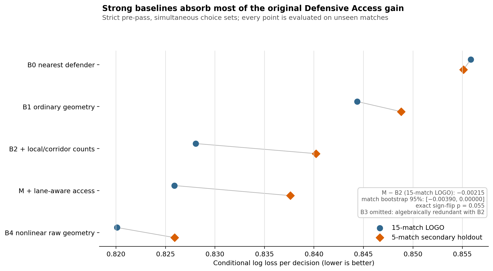
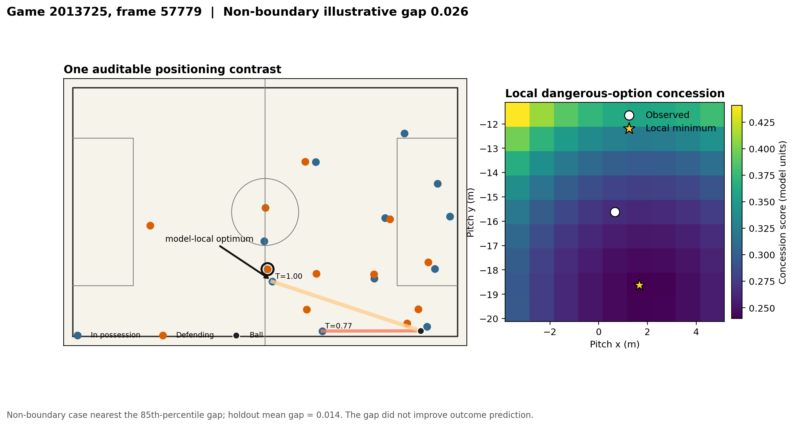
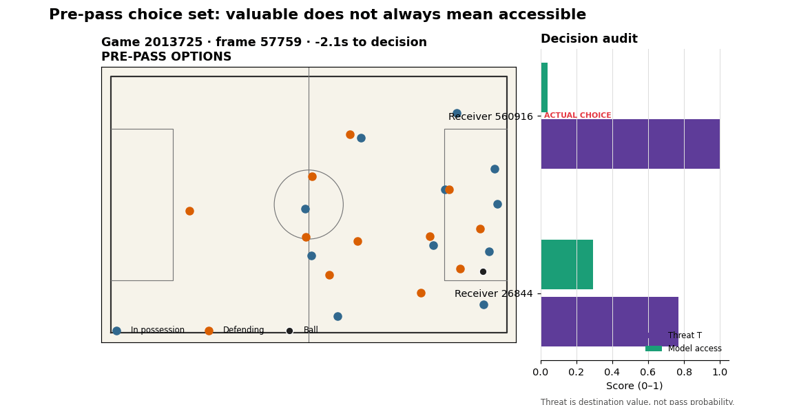

# Defensive Access

**How much does a defender's position reduce the opponent's usable options?**

Defensive Access is an independent, reproducible study of defensive positioning with SkillCorner Open Data. It measures pressure, cover-shadow obstruction, receiver accessibility and each defender's counterfactual contribution, then converts noisy frame observations into stable tactical intervals.

The project is being developed for Analytics Cup 2.0. It uses only the permitted SkillCorner Australia A-League 2024/25 data. It is not affiliated with or endorsed by SkillCorner, PySport, the A-League or any club.

## Sporting question

Conventional pressure metrics reward proximity to the ball. Coaches need a harder answer: did the defender's position remove valuable choices while preserving the team structure?

For every usable tracking frame, the model:

1. estimates every potential receiver's control margin from ball and defender arrival times;
2. measures whether defenders obstruct the ball-to-receiver lane;
3. combines the best available options into team attacking access;
4. removes each defender in turn and recomputes access;
5. attributes the access increase to that defender's positioning;
6. exposes an experimental Viterbi layer for stable tactical intervals; state labels remain outside headline claims until match-held-out validation passes.

The contribution is explicitly counterfactual but not causal: it asks what this geometry implies if one observed defender is absent. It does not claim what would have happened in the match.

## Why it matters

The resulting audit separates four ideas that are often collapsed into one pressure number:

- **ball pressure** — arrival distance to the current ball location;
- **lane control** — obstruction between ball carrier and receiver;
- **receiver control margin** — defender arrival time minus ball arrival time;
- **structural protection** — width, length, hull area and temporal state.

This supports coaching review, opponent analysis and scouting without pretending that broadcast-derived tracking is error-free. Every output includes detection coverage and explicit exclusion reasons.

## Main result

The first pooled analysis found a +0.0185 AUC gain over nearest-defender distance. A frozen re-analysis showed why that comparison was too easy: options occurred at different times, nearest-frame alignment could look after the event, and the baseline omitted ordinary pass geometry.

The corrected design uses 7,617 simultaneous, strictly pre-pass choice sets across 20 matches. Fifteen development matches use leave-one-match-out evaluation; five secondary-holdout matches are opened only after model settings are fixed.

On the secondary holdout, ordinary geometry (B2) reaches log loss **0.8402** and top-1 **56.97%**. Adding Defensive Access lane/arrival features changes these to **0.8376** and **56.64%**: a small probability-loss improvement without a ranking improvement. A nonlinear raw-geometry GBM is stronger at **0.8259** and **57.59%**.

The prespecified timing falsification is decisive. On 3,113 identical choice sets, the incremental log-loss effect versus B2 is −0.00029 immediately before the pass and +0.00038 half a second earlier. The project therefore does **not** claim that the current score measures stable defensive-position quality. Its contribution is the audit: pooled option AUC can overstate value, fixed-speed control margin is linearly redundant with distance inputs, and decision-time choice-set evaluation changes the sporting conclusion.



The defensively relevant extension weights available options by forward progression, final-third entry and box entry. These Phase 2 outcomes are exploratory. Lane-aware dangerous-option concession changes `lead_to_shot` AUC from 0.661 to 0.675 in development and from 0.658 to 0.663 in the secondary holdout. The holdout log-loss difference is −0.00126 with a match-bootstrap interval [−0.00386, +0.00199]: directionally consistent, tiny and difficult to distinguish from zero. This holdout is not organiser-hidden because earlier pooled summaries had been seen. Local position maps are exposed for video review, but Positioning Gap worsens holdout loss and is **not** a player rating or coaching optimum.



### One decision, reconstructed

The animation below replays a strictly pre-pass choice set. `T` is transparent destination threat, `Access` is the lane-aware geometry score, and the star marks the receiver actually selected. It is a decision audit—not a claim that the highest-threat option should always be chosen.



## Reproduce

Python 3.10+ is required. Competition data is not redistributed.

```bash
python -m venv .venv
source .venv/bin/activate
bash scripts/reproduce_all.sh --download
```

The script installs the package, runs tests, downloads the pinned official games and rebuilds every table and figure. Omit `--download` when data already exists. It writes:

- `frame_metrics.csv`: access, pressure, shape, coverage and decoded state;
- `receiver_access.csv`: lane obstruction and arrival-time margins;
- `defender_contributions.csv`: counterfactual contribution by player and frame;
- `audit.json`: valid-frame coverage and exclusion reasons.

## Validation design

The metric is evaluated out of sample by match, not by random frame. Primary validation asks whether receiver access predicts the selected receiver **within the options simultaneously available immediately before a pass**, beyond a ladder of equal-capacity geometry baselines. A separate role-complementarity analysis studies `force_backward`, danger reduction, `regain` and `disruption`; it does not assume the ball engager must also be the principal passing-lane defender. Match-level bootstrap, exact paired sign flips and leave-one-match-out evaluation preserve the effective sample size.

Ablations remove lane obstruction, arrival-time margin, counterfactual attribution and temporal smoothing. Sensitivity checks vary assumed defender speed, pass speed, sampling frequency, visibility thresholds and the state-switch penalty. No event outcome is used to define the transparent version of the metric.

## Project map

- [`docs/research_protocol.md`](docs/research_protocol.md): hypotheses, estimands and validation
- [`docs/data_contract.md`](docs/data_contract.md): fields and quality policy
- [`reports/full_results.md`](reports/full_results.md): superseded pooled validation, retained for audit history
- [`reports/phase01_choice_set_validation.md`](reports/phase01_choice_set_validation.md): strict choice-set re-analysis and decision
- [`reports/phase23_defensive_value.md`](reports/phase23_defensive_value.md): dangerous-option validity and counterfactual limits
- [`reports/analytics_cup_submission.md`](reports/analytics_cup_submission.md): one-minute pitch and claim boundaries
- [`src/defensive_access`](src/defensive_access): importable package
- [`tests`](tests): geometry, counterfactual, temporal and interval invariants

## Licence and data

Code is MIT licensed. SkillCorner data remains under its own terms and is intentionally excluded from this repository. Cite the pinned upstream version recorded in `datasets.lock.json`.

