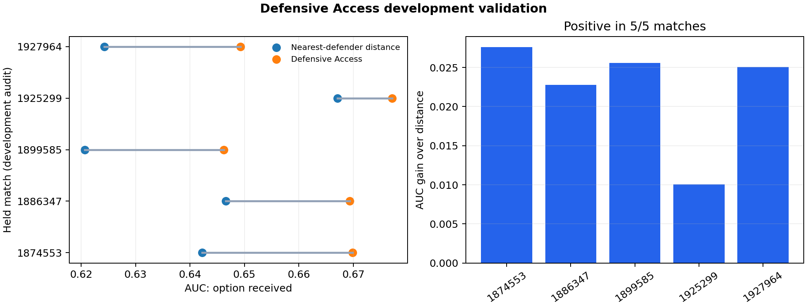

# Development validation — not the final competition result

Five matches were selected to exercise the full pipeline before the locked 20-match analysis. They are a development audit, not a hidden test set and not a basis for confirmatory claims.

## Result

- 11,256 passing options aligned to tracking within a median of one frame.
- Defensive Access AUC exceeded nearest-defender-distance AUC in 5/5 matches.
- Mean match-level AUC gain: +0.0222.
- Range: +0.0101 to +0.0276.
- Exact two-sided sign-flip p-value across five matches: 0.0625.
- Valid sampled-frame coverage: 47.6% to 62.2%.

The exact test cannot cross 0.05 with only five same-sign match differences (minimum two-sided p = 0.0625). The correct conclusion is consistent preliminary improvement, not statistical confirmation.

## Failure discovered and retained

Counterfactual lane contribution of the player recorded as the on-ball engager did not consistently rank engagement success. That estimand conflated the player attacking the ball with teammates protecting passing lanes. The project therefore separates receiver-access validation from a later role-complementarity analysis instead of tuning the sign after seeing outcomes.

## Locked next analysis

Before processing the remaining matches, freeze feature definitions, speeds, alignment tolerance and exclusions. Run the same pipeline on all remaining eligible matches, report every match, and use match-grouped uncertainty. The heuristic phase decoder is experimental and excluded from headline claims until it passes leave-one-match-out validation against official phase labels.
