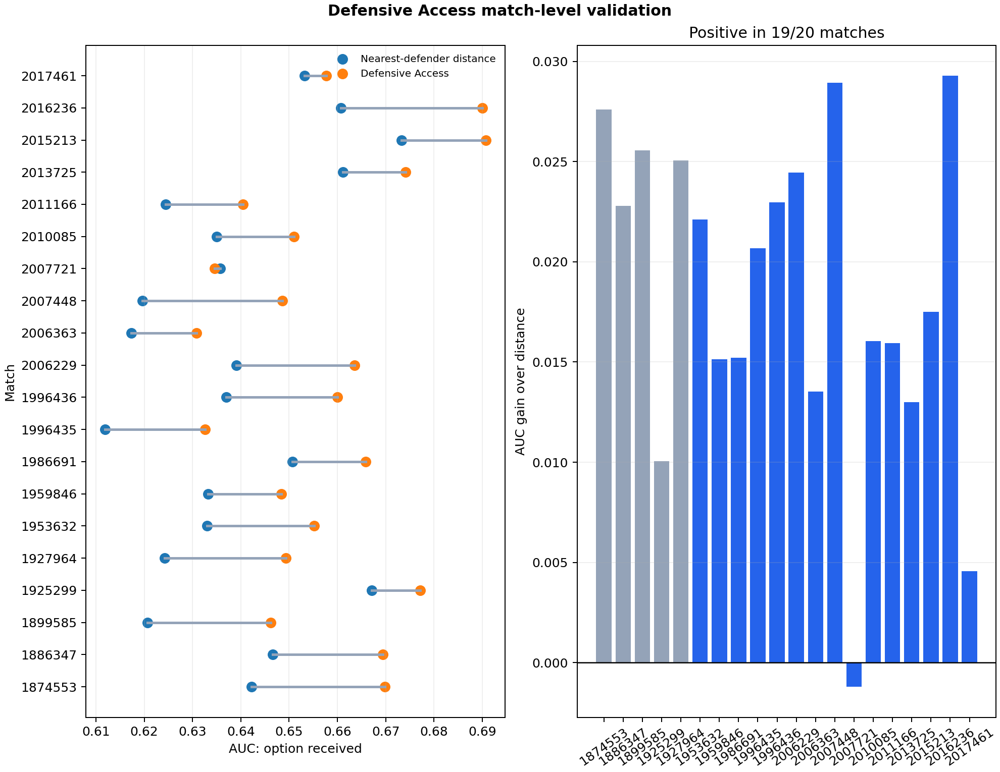

# Superseded exploratory pooled validation

> This analysis is retained for audit history. Its headline claim is superseded by
> [`phase01_choice_set_validation.md`](phase01_choice_set_validation.md), which uses
> strict pre-pass timing, simultaneous choice sets and strong geometry baselines.

Five matches were used to exercise the pipeline and freeze definitions. The remaining 15 matches were processed without changing feature coefficients, speed assumptions, alignment tolerance, stride or exclusions.

## Result

- 40,347 passing options aligned to tracking across 20 matches.
- Defensive Access AUC exceeded nearest-defender-distance AUC in 19/20 matches.
- All-match mean AUC gain: +0.0185; match-bootstrap 95% interval [+0.0149, +0.0218].
- Range: -0.0012 to +0.0293.
- Exact two-sided sign-flip p-value across 20 matches: 0.000004.
- Locked 15-match mean gain: +0.0172; bootstrap interval [+0.0131, +0.0210], exact sign-flip p = 0.000122.
- Development-five mean gain: +0.0222.
- Valid sampled-frame coverage: 37.8% to 62.2%.

The single negative match is retained. Intervals resample matches, not frames; the 15-match analysis is locked validation but not an organiser-held hidden test.

## Failure discovered and retained

Counterfactual lane contribution of the player recorded as the on-ball engager did not consistently rank engagement success. That estimand conflated the player attacking the ball with teammates protecting passing lanes. The project therefore separates receiver-access validation from a later role-complementarity analysis instead of tuning the sign after seeing outcomes.

## Remaining limits

`received` measures option use, not pass completion or causal defensive value. Event labels and tracking are products of the same provider and may share upstream modelling assumptions. The heuristic phase decoder remains experimental and is excluded from headline claims until it passes leave-one-match-out validation against official phase labels.
